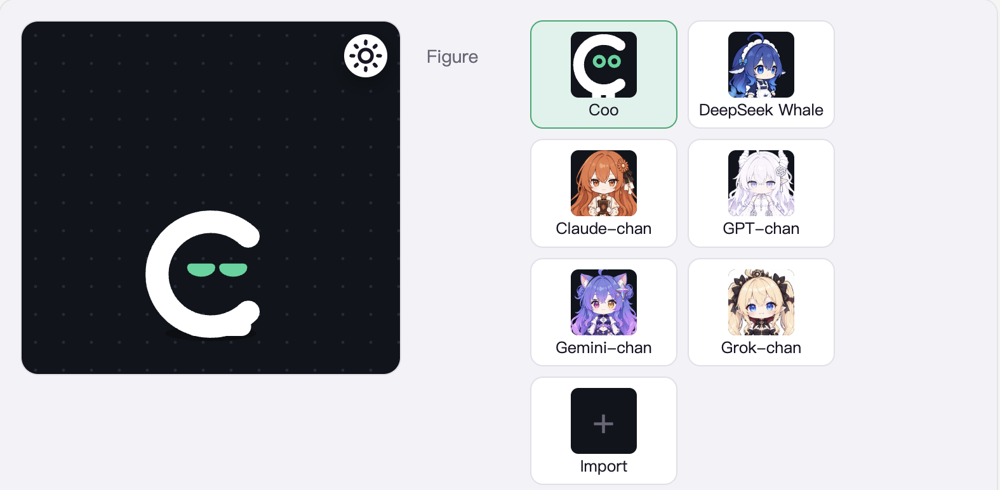

<p align="center">
  <picture>
    <source media="(prefers-color-scheme: dark)" srcset="assets/banner-dark.svg">
    
  </picture>
</p>

<p align="center">
  English ｜
  <a href="README_zh.md">简体中文</a>
</p>

<p align="center">
  <a href="https://github.com/yxengram/Coopanion/releases/latest"></a>
  <a href="https://github.com/yxengram/Coopanion/actions/workflows/ci.yml"></a>
  
  
  
  <a href="LICENSE"></a>
</p>

<p align="center">
  <a href="#how-this-fork-differs">How this fork differs</a> ｜
  <a href="#download-figure-packs">Figure packs</a> ｜
  <a href="#install">Install</a> ｜
  <a href="https://github.com/yxengram/Coopanion/releases">Changelog</a> ｜
  <a href="docs/DEVELOPMENT.md">Development</a>
</p>

This is a fork of the desktop pet [Coopanion](https://github.com/Pal-AI-Lab/Coopanion). Coopanion's pet **Coo** lives on the bottom edge of your screen: it chats with you in speech bubbles, listens when you talk, walks along the edge, and with your permission can use your computer. It runs on Windows, macOS and Linux.

This fork adds four new figures, over a hundred expressions and motions, and the optional "expression decisions" and "small talk". Setting up, changing models, voice input and computer use work mostly as in upstream, so [upstream's README](https://github.com/Pal-AI-Lab/Coopanion#readme) is a useful guide; this page covers only what is different here. To install this fork, use the links on this page.



## How this fork differs

### What it adds

- **Six figures**: besides Coo and the DeepSeek Whale there are **Claude-chan**, **GPT-chan** (a white dragon girl), **Gemini-chan** (a cat girl) and **Grok-chan** (a little vampire princess). You can pick any of the six during the first-run guide. Each of the four girls has two outfits, classic and winter. Upstream's whale also has the winter outfit (a whale hood and cape); here it gets drawings of its own for her hand motions and for whole-body poses such as kneeling, lying down and rolling, with the whole-body poses drawn in each of her eight color schemes.
- **More expressions and motions**: upstream's Coo and whale know 37 words each. Here Coo knows 108, the whale 133, and the four girls 132–137. New expressions include awkward, giggle, petrified, eye-roll, shocked and soul leaving the body; new motions include cheer, heart hands, roll, sipping tea, reading, singing, clapping and patting your head, most with a sound of their own. Every figure can kneel and lie down; the whale and the four girls have drawings of their own for both, and can do hand motions while kneeling.
- **Several things at once**: words joined with + happen together, such as "sit+happy+wave". Two expressions that fit together merge into one face, the eyes of one with the mouth of the other: the girls know 136 such pairs, the whale 122 and Coo 24. Many words also accept common alternatives; for example 挥手 and 拜拜 both mean wave.
- **Expression decisions (off by default; needs an OpenRouter key)**: Coo writes only one line about how it feels for each thing it says. A decision model on OpenRouter then picks the face, head, hands, body and pose. The prompt no longer needs the full word table, and words from third-party figure packs work without changes.
- **Small talk (off by default)**: when you are at your computer but haven't talked to Coo for a while, or have just come back, it may say a line or two on its own. You can choose how often (low, medium, high) and set quiet hours.
- **Walking**: besides walking over to your pointer (as in upstream), Coo can walk away from it to make room, or walk a given distance left or right. After a walk it knows where the pointer is.
- **Figure packs for upstream**: the whale and the four girls are exported as figure packs that upstream Coopanion can import; see [Download figure packs](#download-figure-packs).
- **A few safety details**:
  - Keys for OpenAI, Anthropic, Gemini and xAI are never replaced by environment variables of the same name from where the app was started, and an Anthropic connection doesn't read tokens from that environment either.
  - The ChatGPT sign-in is bound to the path of the connection's folder: after the connection is duplicated or renamed, or the data folder is copied or moved, sign in again.
  - When a transcription service asks to redirect, the request fails, so recordings are never sent on to another address.

More detail on the figures, expressions and motions, expression decisions and small talk is in [docs/FORK.en.md](docs/FORK.en.md). What changed in each version is in [Releases](https://github.com/yxengram/Coopanion/releases).

### What works differently

- **Version numbers**: this fork is at 0.12.0, upstream at 0.2.x; each numbers its own releases.
- **Where updates come from**: auto-update, download links and the one-line installer all point at this fork (yxengram/Coopanion), not upstream.
- **Usage statistics**: this fork sends no anonymous statistics at all and creates no install ID. Upstream sends them by default; you can turn that off in its settings.
- **Computer use**: on by default, but Coo asks you before each round of looking at the screen or using the mouse and keyboard. Upstream has it off by default.
- **Settings window**: in normal mode, Computer use has a page of its own; the Extensions page appears only in advanced mode (upstream calls it World extensions and shows it in normal mode).
- **Languages**: only Chinese and English are complete; the nine other languages translate only the pages that come from Cortico. The prompts sent to the model are always in Chinese, and Coo answers in the app's language.

### What upstream has and this fork doesn't

This fork follows upstream up to v0.2.13 (Cortico 0.2.9), and some upstream features from before that were never ported either. For example:

- Upstream changes from v0.2.14 on:
  - a sound volume slider and a switch for panning sound left and right with Coo's position (here panning is always on), an "Auto update" switch, and "Click through" in the tray menu;
  - speaking with the talk key interrupts Coo;
  - the redesigned settings window and extension market;
  - moving eye highlights for the whale, and Coo's new color scheme Nai Coo;
  - packs reading files in their own folder (Live2D models, for example), and figure packs over 128 MB, which this fork doesn't accept;
  - a set of fixes, such as the position on two screens with different scaling, the pet stepping back while the App Store is in front, and asking you to reinstall after an incomplete install.
- Figures and packs:
  - the whale's third outfit, the Crew uniform;
  - Coo's color schemes Principle: Lantern, Grail, Forge, Heart and Winter;
  - walk targets declared by a pack (standing on top of a window, for example).
- Computer use: upstream asks you once more before Coo types into a terminal or presses Win+R; this fork has no such extra check.
- Settings and the guide: OBS output, the alarm list, status icons above Coo's head, `PARTNER.md` memory with its Git history, and choosing Coo's temperament and how it responds to interactions during the guide.
- Languages and models: 11 complete UI languages, Whisper speech recognition, the international platforms of several model services, the Chat Completions protocol, and StepFun Step Plan.
- The Steam version.

If you need any of these, use [upstream Coopanion](https://github.com/Pal-AI-Lab/Coopanion). If you only want the figures from here, import the figure packs below into upstream.

## Download figure packs

These packs are for **upstream Coopanion** (Pal-AI-Lab/Coopanion). This fork already has these figures built in, so you don't need them here.

Upstream v0.1.20 and later: on the Dress up page, click "Import" at the end of the Figure row and pick the downloaded zip; no restart needed. For older versions, copy the folder as the README inside each pack describes.

| Download | Figure | Expressions and motions | Outfits | Size |
| -------- | ------ | ----------------------- | ------- | ---- |
| [**All five**](https://github.com/yxengram/Coopanion/releases/download/packs-v0.12.0/coopanion-all-figures.zip) | the five below in one zip | | | 184 MB |
| [coopanion-whale.zip](https://github.com/yxengram/Coopanion/releases/download/packs-v0.12.0/coopanion-whale.zip) | DeepSeek Whale | 133 | 8 color schemes × maid / winter | 58 MB |
| [coopanion-claude-chan.zip](https://github.com/yxengram/Coopanion/releases/download/packs-v0.12.0/coopanion-claude-chan.zip) | Claude-chan | 132 | classic / winter | 27 MB |
| [coopanion-gpt-chan.zip](https://github.com/yxengram/Coopanion/releases/download/packs-v0.12.0/coopanion-gpt-chan.zip) | GPT-chan | 134 | classic / winter | 41 MB |
| [coopanion-gemini-chan.zip](https://github.com/yxengram/Coopanion/releases/download/packs-v0.12.0/coopanion-gemini-chan.zip) | Gemini-chan | 137 | classic / winter | 26 MB |
| [coopanion-grok-chan.zip](https://github.com/yxengram/Coopanion/releases/download/packs-v0.12.0/coopanion-grok-chan.zip) | Grok-chan | 133 | classic / winter | 33 MB |

Importing "All five" lists all five figures, all checked, so you can install them in one go. It is over 128 MB, so it needs upstream v0.2.16 or later, which warns that it is large (go ahead anyway); older versions refuse packs that big, so import the single packs one by one there.

Tested with upstream v0.2.17's import: each pack on its own and "All five" install and display correctly. Checksums are in [SHA256SUMS](https://github.com/yxengram/Coopanion/releases/download/packs-v0.12.0/SHA256SUMS); every file is also on the [packs-v0.12.0](https://github.com/yxengram/Coopanion/releases/tag/packs-v0.12.0) page. The packs' READMEs are in Chinese.

For the artwork's license, see [License](#license) below: the four girls' art is for non-commercial use only.

## Install

You need:

- Windows 10 / 11 (64-bit), macOS 13 or later, or a 64-bit Linux desktop;
- an API key for a model service (DeepSeek if you're unsure), or a ChatGPT account with a plan (signing in with a plan is still in testing).

None of the downloads are signed, so your system may stop the app the first time you open it.

- **Windows**:
  - **Installer**: download `Coopanion-Setup-<version>.exe` from the [latest release](https://github.com/yxengram/Coopanion/releases/latest) and run it. If you see "Windows protected your PC", click "More info" → "Run anyway".
  - **One command**: run this line in PowerShell.

    ```powershell
    irm https://raw.githubusercontent.com/yxengram/Coopanion/main/installer/install.ps1 | iex
    ```

  - **Portable**: download `Coopanion-<version>-win-x64-portable.zip`, unzip it and run `Coopanion.exe`. Its data stays in the `data` folder next to it. The portable version doesn't update itself.
- **macOS**: download `Coopanion-<version>-mac-arm64.dmg` (Apple silicon) or `…-mac-x64.dmg` (Intel) and drag Coopanion into Applications. If it is blocked the first time, go to System Settings → Privacy & Security and click "Open Anyway".
- **Linux**:
  - deb: run `sudo apt install ./Coopanion-<version>-linux-x64.deb`.
  - AppImage: install FUSE 2 first, run `chmod +x Coopanion-*.AppImage`, then run the file.

On first start, Coo walks you through setup in its bubbles.

| System  | Data location                                     |
| ------- | ------------------------------------------------- |
| Windows | `data` in the install folder (by default `C:\Users\<you>\Coopanion`); for the portable version, `data` in its own folder |
| macOS   | `~/Library/Application Support/Coopanion`         |
| Linux   | `~/.config/Coopanion`                             |

For permissions, the FAQ and more, see [upstream's README](https://github.com/Pal-AI-Lab/Coopanion#readme). Its download links get upstream's builds; to install this fork, use the links above. This fork's own full guide as of v0.12.0 is still available: see [that version's README](https://github.com/yxengram/Coopanion/blob/v0.12.0/README.md).

## Feedback and contributing

- Report problems and ideas for this fork in its [Issues](https://github.com/yxengram/Coopanion/issues), with your OS version, Coopanion version and steps to reproduce.
- To build from source or change the code, see the [development guide](docs/DEVELOPMENT.md).

## Acknowledgements

Coopanion is made by [Pal-AI-Lab](https://github.com/Pal-AI-Lab) and assembled from [Cortico](https://github.com/Pal-AI-Lab/Cortico): Cortico Core + Cormini Persona + the [desktop pet World](packages/cortico-world-desktop-pet) + the [computer use World](packages/cortico-world-cua).

## License

[AGPL-3.0-or-later](LICENSE). Releases up to and including 0.1.10 are MIT. The Cortico framework is MIT and ships as a submodule. To open a PR see [CONTRIBUTING.md](CONTRIBUTING.md); contributions are released under AGPL-3.0-or-later, no contributor agreement to sign.

The DeepSeek Whale artwork (the textures under `packages/cortico-world-desktop-pet/web/whale/`) is not covered by the AGPL; its origin is described in the [desktop pet World's third-party notices](packages/cortico-world-desktop-pet/THIRD_PARTY_NOTICES.md). Nor is the Claude-chan artwork (the textures and thumbnail under `packages/cortico-world-desktop-pet/web/claude-chan/`): she is the Claude fan character designed by ZipZipPipe（Bilibili）, whose design is free for non-commercial use only; this figure's art was generated with GPT image models after that design, then cut into layers by this project, and is likewise for non-commercial use only. Nor is the GPT-chan artwork (the textures and thumbnail under `packages/cortico-world-desktop-pet/web/gpt-chan/`): she is the GPT fan character designed by ZipZipPipe（Bilibili）, whose design is free for non-commercial use only; this figure's art was generated with GPT image models after that design, then cut into layers by this project, and is likewise for non-commercial use only. Nor is the Gemini-chan artwork (the textures and thumbnail under `packages/cortico-world-desktop-pet/web/gemini-chan/`): she is the Gemini fan character designed by ZipZipPipe（Bilibili）, whose design is free for non-commercial use only; this figure's art was generated with GPT image models after that design, then cut into layers by this project, and is likewise for non-commercial use only. Nor is the Grok-chan artwork (the textures and thumbnail under `packages/cortico-world-desktop-pet/web/grok-chan/`): she is the Grok fan character designed by ZipZipPipe（Bilibili）, whose design is free for non-commercial use only; this figure's art was generated with GPT image models after that design, then cut into layers by this project, and is likewise for non-commercial use only. The speech's syllable bank (`packages/cortico-world-desktop-pet/web/speech/`) was spoken syllable by syllable by Microsoft Edge's read-aloud service with the `zh-CN-XiaoyiNeural` voice and, not having been authored by this project, is not covered by the AGPL; its pronouncing data are the CMU Pronouncing Dictionary (BSD-style license), mecab-ipadic (its own permissive license, NAIST), the Unicode Unihan database (Unicode License v3), pypinyin and pinyin-data (MIT), and the jukujikun of the Jōyō kanji table's appendix (a Japanese government notice, not under copyright); the speech code and data come from upstream Coopanion (v0.2.7, #263 and #265), and details and license texts are in the desktop pet World's third-party notices. Third-party components shipped or downloaded at runtime: Electron (MIT), Cortico (MIT), sherpa-onnx (Apache-2.0), FunASR's SenseVoiceSmall model ([FunASR model license](https://github.com/modelscope/FunASR/blob/main/MODEL_LICENSE), downloaded on use), koffi (MIT), jpeg-js (BSD-3-Clause), pnpm (MIT); model service logos come from [lobe-icons](https://github.com/lobehub/lobe-icons) (MIT; each logo belongs to its company and only identifies the service).
