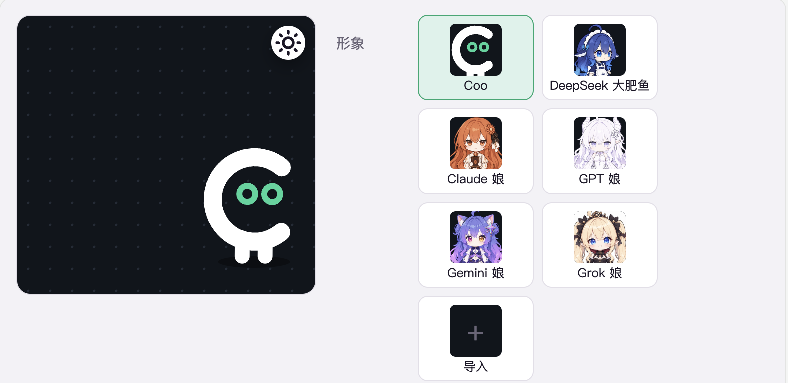

<p align="center">
  <picture>
    <source media="(prefers-color-scheme: dark)" srcset="assets/banner-dark.svg">
    
  </picture>
</p>

<p align="center">
  <a href="README.md">English</a> ｜
  简体中文
</p>

<p align="center">
  <a href="https://github.com/yxengram/Coopanion/releases/latest"></a>
  <a href="https://github.com/yxengram/Coopanion/actions/workflows/ci.yml"></a>
  
  
  
  <a href="LICENSE"></a>
</p>

<p align="center">
  <a href="#和上游的不同">和上游的不同</a> ｜
  <a href="#下载形象包">下载形象包</a> ｜
  <a href="#安装">安装</a> ｜
  <a href="https://github.com/yxengram/Coopanion/releases">更新记录</a> ｜
  <a href="docs/DEVELOPMENT.md">参与开发</a>
</p>

这是桌宠 [Coopanion](https://github.com/Pal-AI-Lab/Coopanion) 的一个分支（fork）。Coopanion 的桌宠 **Coo** 待在屏幕底边，用气泡和你聊天、听你说话、在底边走动，经你同意后还能操作电脑，支持 Windows、macOS 和 Linux。

这个分支加了四个新形象、一百多个表情和动作，还有可选的「表情决策」和「主动闲聊」。设置、换模型、语音输入、操作电脑这些基本用法和上游大体一样，可以参考[上游的 README](https://github.com/Pal-AI-Lab/Coopanion/blob/main/README_zh.md)；这里只写这个分支哪里不同，安装请用本页的链接。



## 和上游的不同

### 多了什么

- **六个形象**：除了 Coo 和 DeepSeek 大肥鱼，还有 **Claude 娘**、**GPT 娘**（白色小龙娘）、**Gemini 娘**（猫娘）和 **Grok 娘**（吸血鬼小公主）。第一次引导时就能在六个里挑一个。四位娘都有常服和冬装两套服装。大肥鱼的冬装（鲸鱼兜帽和斗篷）上游也有，这里给它的手上动作单独画了冬装版，跪坐、趴下、翻滚这些整身姿势也画了，整身姿势八套配色各一份。
- **更多表情和动作**：上游的 Coo 和大肥鱼各认得 37 个词。这里 Coo 认得 108 个，大肥鱼 133 个，四位娘 132–137 个。新增的表情有尴尬、偷笑、石化、翻白眼、震惊、灵魂出窍等，动作有欢呼、比心、翻滚、喝茶、看书、唱歌、拍手、摸摸头等，大多带自己的音效。所有形象都会跪坐和趴下；大肥鱼和四位娘的跪坐、趴下有专门的画，跪着也能做手上的动作。
- **同时做几件事**：用 + 连起几个词就同时做，比如「坐下+开心+招手」。两个能搭配的表情会合成一张脸，用一个的眼睛配另一个的嘴，四位娘认得 136 对、大肥鱼 122 对、Coo 24 对。很多词还认得常见说法，比如挥手、拜拜都算招手。
- **表情决策（默认关，要 OpenRouter 密钥）**：Coo 每句话只写一句心情，再由 OpenRouter 上的决策模型替它挑表情、头、手、身体和姿势。这样提示词里不用放整张词表，第三方形象包的词也能直接用上。
- **主动闲聊（默认关）**：你在电脑前一阵没理 Coo，或者离开后刚回来时，它可能主动说一两句。频率分少、中、多三档，可以设免打扰时段。
- **走动**：除了走到鼠标旁边（上游也有），Coo 还能背着鼠标走开给你让地方，或者往左右走一段指定的距离。走完它知道鼠标在哪。
- **给原版用的形象包**：大肥鱼和四位娘导出成了形象包，可以装进原版 Coopanion，见[下载形象包](#下载形象包)。
- **几处安全细节**：
  - OpenAI、Anthropic、Gemini、xAI 的 Key 不会被启动环境里的同名环境变量顶替；连 Anthropic 时也不读启动环境里的令牌。
  - ChatGPT 的登录凭据和连接所在文件夹的路径绑定：连接被复制、改名，或者数据文件夹被复制、移动以后，要重新登录。
  - 转写接口要求跳转时直接算失败，录音不会被转发到别的地址。

形象、表情动作、表情决策和主动闲聊的详细说明在 [docs/FORK.md](docs/FORK.md)。每个版本改了什么，见 [Releases](https://github.com/yxengram/Coopanion/releases)。

### 不一样的地方

- **版本号**：这个分支现在是 0.12.0，上游是 0.2.x，两边各自编号。
- **更新来源**：自动更新、下载链接和一行安装命令都指向这个分支（yxengram/Coopanion），不指向上游。
- **使用统计**：这个分支不发送任何匿名统计，也不生成安装编号。上游默认发送，可以在设置里关掉。
- **电脑操作**：默认开着，但 Coo 每一轮看屏幕或动鼠标键盘之前都会先问你。上游默认关着。
- **设置窗口**：普通模式里「电脑操作」是单独的一页，「World 扩展」只在高级模式里。
- **界面语言**：只有中文和英文是完整的界面，另外九种语言只翻译了来自 Cortico 的页面。发给模型的提示词一直是中文，Coo 用界面语言回答你。

### 上游有、这个分支没有的

这个分支跟进到上游 v0.2.13（Cortico 0.2.9）为止；在那之前的上游功能，也有一些没有移植。比如：

- 上游 v0.2.14 起的改动：
  - 音效音量滑条和左右声道的开关（这里声音一直随 Coo 的位置偏左偏右，不能关）、「自动更新」开关、托盘里的「鼠标穿透」；
  - 按说话键说话可以打断 Coo；
  - 改版后的设置窗口和扩展市场；
  - 大肥鱼会动的眼睛高光，Coo 的新配色「奶Coo」；
  - 形象包读自己目录里的文件（比如 Live2D 模型），以及超过 128 MB 的形象包（这里不收）；
  - 一批修复，比如两块屏幕缩放不同时的位置、App Store 在前台时桌宠让开、安装不完整时提示重装。
- 形象和形象包：
  - 大肥鱼的第三套服装「店员装」；
  - Coo 的配色「性相：灯、杯、铸、心、冬」；
  - 形象包自己声明的走动目标（比如站到窗口顶上）。
- 设置和引导：OBS 画面导出、闹钟列表、头顶的状态小图标、`PARTNER.md` 记忆和它的 Git 版本记录、引导里挑 Coo 的性子和回应方式。
- 语言和模型：11 种完整的界面语言、Whisper 语音识别、几家模型服务的国际平台、Chat Completions 协议、阶跃 Step Plan。
- Steam 版。

需要这些功能的话，请用[上游的 Coopanion](https://github.com/Pal-AI-Lab/Coopanion)。如果只是想要这里的形象，可以在上游里导入下面的形象包。

## 下载形象包

这些包是给**原版 Coopanion**（Pal-AI-Lab/Coopanion）用的。这个分支已经内置了这些形象，不用另外装。

原版 v0.1.20 及以后：在装扮页「形象」一行的最后点「导入」，选下载好的 zip，不用重启。更早的版本，按包里 README 的说明复制文件夹。

| 下载 | 形象 | 表情和动作 | 服装 | 大小 |
| ---- | ---- | ---------- | ---- | ---- |
| [**全部五个**](https://github.com/yxengram/Coopanion/releases/download/packs-v0.12.0/coopanion-all-figures.zip) | 下面五个都在一个 zip 里 | | | 184 MB |
| [coopanion-whale.zip](https://github.com/yxengram/Coopanion/releases/download/packs-v0.12.0/coopanion-whale.zip) | 大肥鱼 | 133 | 8 套配色 × 女仆装 / 冬装 | 58 MB |
| [coopanion-claude-chan.zip](https://github.com/yxengram/Coopanion/releases/download/packs-v0.12.0/coopanion-claude-chan.zip) | Claude 娘 | 132 | 常服 / 冬装 | 27 MB |
| [coopanion-gpt-chan.zip](https://github.com/yxengram/Coopanion/releases/download/packs-v0.12.0/coopanion-gpt-chan.zip) | GPT 娘 | 134 | 常服 / 冬装 | 41 MB |
| [coopanion-gemini-chan.zip](https://github.com/yxengram/Coopanion/releases/download/packs-v0.12.0/coopanion-gemini-chan.zip) | Gemini 娘 | 137 | 常服 / 冬装 | 26 MB |
| [coopanion-grok-chan.zip](https://github.com/yxengram/Coopanion/releases/download/packs-v0.12.0/coopanion-grok-chan.zip) | Grok 娘 | 133 | 常服 / 冬装 | 33 MB |

导入「全部五个」时会列出五个形象，默认都勾上，一次就能装好。它超过 128 MB，要原版 v0.2.16 及以后才能导入（会提示文件较大，确认即可）；更早的原版不收这么大的包，请一个一个导入单独的包。

用原版 v0.2.17 的导入功能试过：五个单独的包和「全部五个」都能装上、正常显示。校验值见 [SHA256SUMS](https://github.com/yxengram/Coopanion/releases/download/packs-v0.12.0/SHA256SUMS)，所有文件也可以在 [packs-v0.12.0](https://github.com/yxengram/Coopanion/releases/tag/packs-v0.12.0) 页面下载。

贴图的许可见下面的[许可](#许可)：四位娘的贴图只限非商业使用。

## 安装

你需要：

- Windows 10 / 11（64 位）、macOS 13 及以上，或者 64 位 Linux 桌面；
- 一家模型服务的 API Key（拿不准就选 DeepSeek），或者一个开了套餐的 ChatGPT 账号（用套餐登录还在测试中）。

安装包都没有数字签名，第一次打开时系统可能会拦一下。

- **Windows**：
  - **安装包**：从[最新发布](https://github.com/yxengram/Coopanion/releases/latest)下载 `Coopanion-Setup-版本号.exe` 并运行。提示「Windows 已保护你的电脑」时，点「更多信息」→「仍要运行」。
  - **一行命令**：在 PowerShell 里运行下面这行。

    ```powershell
    irm https://raw.githubusercontent.com/yxengram/Coopanion/main/installer/install.ps1 | iex
    ```

  - **便携版**：下载 `Coopanion-版本号-win-x64-portable.zip`，解压后运行 `Coopanion.exe`。数据放在同一个文件夹的 `data` 里。便携版不会自动更新。
- **macOS**：下载 `Coopanion-版本号-mac-arm64.dmg`（Apple 芯片）或 `…-mac-x64.dmg`（Intel），把 Coopanion 拖进「应用程序」。第一次打开被拦下时，到「系统设置 → 隐私与安全性」点「仍要打开」。
- **Linux**：
  - deb：运行 `sudo apt install ./Coopanion-版本号-linux-x64.deb`。
  - AppImage：先装好 FUSE 2，执行 `chmod +x Coopanion-*.AppImage`，再运行它。

第一次启动时，Coo 会在气泡里带你完成设置。

| 系统    | 数据位置                                          |
| ------- | ------------------------------------------------- |
| Windows | 安装目录里的 `data`（默认装在 `C:\Users\你的用户名\Coopanion`）；便携版在它自己文件夹的 `data` |
| macOS   | `~/Library/Application Support/Coopanion`         |
| Linux   | `~/.config/Coopanion`                             |

权限、常见问题等更多说明，见[上游的 README](https://github.com/Pal-AI-Lab/Coopanion/blob/main/README_zh.md)。注意那里的下载链接下载的是上游的版本，安装这个分支请用上面的链接。v0.12.0 时这个分支自己的完整说明也还在：见[那一版的 README](https://github.com/yxengram/Coopanion/blob/v0.12.0/README_zh.md)。

## 反馈与参与

- 这个分支的问题和建议请提到这里的 [Issue](https://github.com/yxengram/Coopanion/issues)，写上系统版本、Coopanion 版本和复现步骤。
- 从源码构建或修改代码，见[开发文档](docs/DEVELOPMENT.md)。

## 致谢

Coopanion 由 [Pal-AI-Lab](https://github.com/Pal-AI-Lab) 开发，用 [Cortico](https://github.com/Pal-AI-Lab/Cortico) 组装：Cortico Core + Cormini Persona + [桌宠 World](packages/cortico-world-desktop-pet) + [电脑操作 World](packages/cortico-world-cua)。

## 许可

[AGPL-3.0-or-later](LICENSE)。0.1.10 及之前发布的版本是 MIT。框架 Cortico 是 MIT，以子模块随附。提 PR 见 [CONTRIBUTING.md](CONTRIBUTING.md)，贡献按 AGPL-3.0-or-later 发布，不用签协议。

DeepSeek 大肥鱼形象（`packages/cortico-world-desktop-pet/web/whale/` 的贴图）不在 AGPL 授权范围内，来源说明见[桌宠 World 的第三方声明](packages/cortico-world-desktop-pet/THIRD_PARTY_NOTICES.md)。Claude 娘形象（`packages/cortico-world-desktop-pet/web/claude-chan/` 的贴图和缩略图）同样不在 AGPL 授权范围内：角色设定是 ZipZipPipe（Bilibili）画的 Claude 同人形象，原作者允许免费非商业使用；这个形象的图由 GPT 图像模型按这个设定生成，再由本项目拆件，所以她的图同样只限非商业使用。GPT 娘形象（`packages/cortico-world-desktop-pet/web/gpt-chan/` 的贴图和缩略图）也不在 AGPL 授权范围内：角色设定是 ZipZipPipe（Bilibili）画的 GPT 同人形象，原作者允许免费非商业使用；这个形象的图由 GPT 图像模型按这个设定生成，再由本项目拆件，所以她的图同样只限非商业使用。Gemini 娘形象（`packages/cortico-world-desktop-pet/web/gemini-chan/` 的贴图和缩略图）也不在 AGPL 授权范围内：角色设定是 ZipZipPipe（Bilibili）画的 Gemini 同人形象，原作者允许免费非商业使用；这个形象的图由 GPT 图像模型按这个设定生成，再由本项目拆件，所以她的图同样只限非商业使用。Grok 娘形象（`packages/cortico-world-desktop-pet/web/grok-chan/` 的贴图和缩略图）也不在 AGPL 授权范围内：角色设定是 ZipZipPipe（Bilibili）画的 Grok 同人形象，原作者允许免费非商业使用；这个形象的图由 GPT 图像模型按这个设定生成，再由本项目拆件，所以她的图同样只限非商业使用。说话声的音节库（`packages/cortico-world-desktop-pet/web/speech/`）由 Microsoft Edge 的朗读服务以 `zh-CN-XiaoyiNeural` 声音逐个念出，不是本项目创作的，不在 AGPL 授权范围内；读音数据取自 CMU Pronouncing Dictionary（BSD 式许可）、mecab-ipadic（NAIST 的宽松许可）、Unicode 的 Unihan 数据库（Unicode License v3）、pypinyin 与 pinyin-data（MIT），以及常用漢字表付表的熟字训（日本政府告示，不受著作权保护）；说话声的代码和数据取自上游 Coopanion（v0.2.7，#263、#265），来源和许可全文见桌宠 World 的第三方声明。随附或运行时下载的第三方组件：Electron（MIT）、Cortico（MIT）、sherpa-onnx（Apache-2.0）、FunASR 的 SenseVoiceSmall 模型（[FunASR 模型开源协议](https://github.com/modelscope/FunASR/blob/main/MODEL_LICENSE)，用时下载）、koffi（MIT）、jpeg-js（BSD-3-Clause）、pnpm（MIT）；各家模型服务的标志取自 [lobe-icons](https://github.com/lobehub/lobe-icons)（MIT，标志归各自公司所有，只用于标明服务）。
